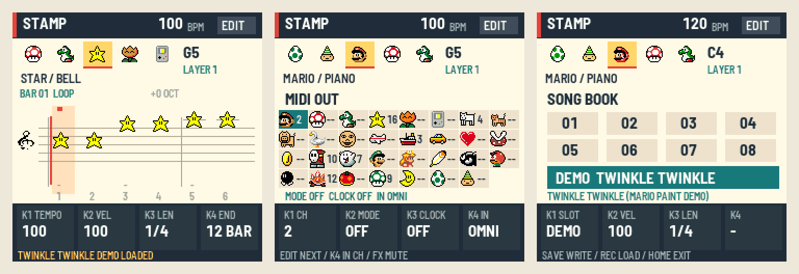
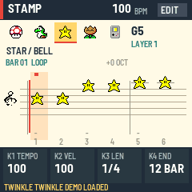
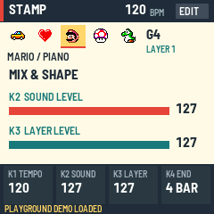
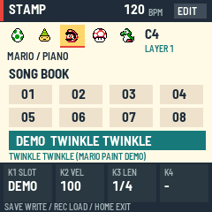

# Stamp Composer FM-1

**Little stamps. Big ideas.** A Mario Paint–inspired music playground for the M-VAVE FM-1.



Pick a character, place a note, and build a song. 31 familiar stamps share one polyphonic engine, with eight layers for arranging, a scrolling staff, and a song book that keeps your ideas close.

[Quick start](#play-in-your-browser) · [Controls](docs/CONTROLS.md) · [Manual](docs/MANUAL.md) · [Build](#build-it) · [Validation](docs/VALIDATION.md)

> **Development preview:** the firmware builds for the FM-1 and runs in the fm1-emu emulator and the browser preview, and the tests pass, but it is **untested on a physical FM-1**. Sounds are the Mario Paint sound pack (Nintendo's, a swappable asset pack: see [its notice](assets/sounds/NOTICE.md)). See the [manual](docs/MANUAL.md) and [install notes](docs/INSTALL.md) before trying a real unit.

## Play in your browser

Download this branch, then serve its included `preview/` folder. No compiler needed:

```sh
python3 -m http.server 8080 --directory preview
```

Open **http://localhost:8080**, choose **Start composing**, then **Load Twinkle demo → Play song**. The demo is Twinkle Twinkle, one of the three demo songs of the original Mario Paint (public-domain melody, our 66-note arrangement for STAR and HEART); loading it can be undone, and on the device it is the song book's DEMO entry. The simulator includes a clickable character palette, the virtual FM-1 panel, a manual, and song import/export.

To make your own tune:

1. Choose a stamp and press a few piano keys to place a chord.
2. Turn **SELECT** to move through time; **SEQ** changes the grid.
3. Press **PLAY** to listen. **ENV / LFO** undo and redo.
4. Press **SAVE** to keep the song in this browser, or **Export song** for a portable `.scf` file.

Drag knobs vertically, or focus one and use the arrow keys. Hold **EDIT** while pressing a note to erase it. Tap **EDIT** for the mixer; **GLO** opens the eight-slot song book. Browser storage belongs to that browser and origin; export your keepers before clearing site data.

## On the little screen

| Compose | Mix & shape | Song book |
| :---: | :---: | :---: |
|  |  |  |
| Character ribbon, ledger lines, sharps and playback marker | Instrument and layer levels | Eight save slots with confirmed loading, then the Twinkle DEMO |

These are captures from the **actual 240 × 240 native application**. The browser runs that same C application as WebAssembly, with simulated controls and storage.

- **31 sounds:** Mario/piano through Gnome, one stamp per Mario Paint instrument, selected per note. They use the real Mario Paint sound pack, an asset pack you can swap (see its notice; Nintendo's sounds are not MIT).
- **Make room for harmony:** a shared eight-voice development default; engine stress tests cover 8, 12 and 16 voices.
- **Build a phrase:** C2–C6 chromatic entry, chords, quarter/eighth/sixteenth and triplet grids, note length, velocity, tempo, time signature (2–12 beats), looping, song end, and editing existing notes in place.
- **Shape the sound:** per-sound tune, tone, decay and pan on a SOUND page; layer and sound levels, mute and solo on MIX.
- **Play it your way:** swing and humanize on a GROOVE page; play from the cursor's bar; a hop-along playback animation.
- **Work on bars:** a BARS page to copy, move, delete, insert and transpose ranges of bars.
- **Talk MIDI:** per-sound MIDI out (channel, ON or MIDI ONLY), clock out and clock in (follow an external clock), and MIDI notes in as key presses.
- **Keep experimenting:** 16 undo levels, eight layers, eight save slots, autosave with restore at power-on, and backup/restore over USB.
- **Help on screen:** hold HOME for a list of the page's controls; screen mirror over USB.
- **Small songs:** up to 384 events, at most 3,202 bytes in the checked SCF1 format.

## Build it

Host requirements: Python 3.11+, Pillow and a C99 compiler. The platform and BSP are pinned submodules.

```sh
git clone --recursive --branch stamp-composer-core https://github.com/MichaelAPerry/MPFM1.git
cd MPFM1
python3 -m pip install Pillow
./tests/run_tests.sh
./build.sh --host
build/host/stamp_host tests/screens.txt build/host
```

The tests cover timing, polyphony, import validation, editing, undo/redo and simulated save/reboot failures. Native screenshots and a WAV recording go into `build/host/`.

For a fresh browser build, put Emscripten on your PATH (tested with 4.0.20):

```sh
./build.sh --web
node tests/web.mjs build/emu/app.wasm build/playground.scf
python3 -m http.server 8080 --directory build/emu
```

For a device build, install the JieLi Linux PI32v2 toolchain and AC79 SDK described by `base/tools/build.py`, set `JIELI_TOOLCHAIN` and `AC79_SDK`, then run `./build.sh`. **No flashable firmware is included.** Package identity is `FM-1_56` (dev `FM-1_5600`); the firmware is untested on hardware. The browser simulator does not execute a PI32 firmware binary.

## Bring a song or sound bank

Convert the supported Super Mario Paint text subset:

```sh
python3 tools/import_smp.py examples/playground.smp build/playground.scf
```

Import the resulting `.scf` through the simulator, then press **SAVE**. Import is refused during playback and can be undone. The converter preserves supported notes, chromatic pitches, line velocity, timing and retrigger cutoffs. It accepts all 31 SMP instruments and rejects legacy MPC, arrangements, extensions, mute commands, noninteger tempos and capacity overruns. Sounds are approximate: one sample per instrument and simplified envelopes. See [the format](docs/FORMAT.md) and [source inspection](docs/RESEARCH.md).

The default sound pack is `assets/sounds/smp_bank.bin` (Mario Paint sounds, see `assets/sounds/NOTICE.md`); rebuild it from `soundset3.sf2` with `tools/make_smp_bank.py`. `STAMP_BANK=placeholder ./build.sh` builds with original generated tones instead. To use your own audio, supply WAVs named as in `tools/make_bank.py` (31 names, any subset; the rest stay placeholder): mono PCM16, 22,050 Hz, root C4, 2 to 65,535 frames each.

```sh
STAMP_WAV_DIR=/absolute/path/to/wavs ./build.sh --host
```

Long or differently formatted inputs are rejected. SoundFont conversion, multisample zones and sustain loops remain unfinished. The included audio is deliberately labeled as development audio; it does not reproduce the original game's sound bank.

## Project notes & credits

The simulator presentation takes inspiration from [Bass Something 2](https://imijes.github.io/bass-something-2/emu/): a clear instrument panel, useful onboarding and documentation close at hand. The implementation uses our pinned [fm1-base](https://github.com/charlesvestal/fm1-base) platform and [felucca-bsp](https://github.com/hugelton/felucca-bsp).

Character PNGs come from [Super Mario Paint](https://github.com/DC37/Super-Mario-Paint), with exact provenance in [assets/NOTICE.md](assets/NOTICE.md). Nintendo character artwork is separate from the MIT application-code license. This is an unaffiliated fan project.

Read [architecture and remaining work](docs/ARCHITECTURE.md), [validation and limitations](docs/VALIDATION.md), and [third-party notices](THIRD_PARTY.md) before building for hardware.
