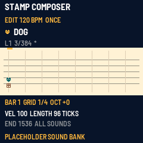

# Stamp Composer FM-1

A native, icon-based composer for the M-VAVE FM-1. Select a sound, place notes with the keys, and play a song. This is an early working application, not a finished firmware release.

The C application runs in fm1-base's host simulator. Fifteen original **placeholder** PCM sounds represent the original composer roles; no Nintendo samples or sprites are bundled. Recognizable original-audio fidelity remains unfinished.



## Try the included preview

After downloading this branch, run `python3 -m http.server 8080 --directory preview` from the repository and open http://localhost:8080. The prebuilt WASM preview needs no compiler. It has the virtual FM-1 panel and SCF1 import/export. It is a development preview with placeholder sounds, not an installer.

## Build and test

Requires Python 3.11+, Pillow, and a C99 compiler for the host. The `base` submodule pins fm1-base and its BSP rather than tracking a moving branch.

```sh
git clone --recursive --branch stamp-composer-core https://github.com/MichaelAPerry/MPFM1.git
cd MPFM1
python3 -m pip install Pillow
./tests/run_tests.sh
```

The script generates the original sample bank, tests the importer and audio core, builds the native host, and executes panel/edit/save tests. Screenshots and a WAV recording appear in `build/host/`.

```sh
./build.sh --host
build/host/stamp_host tests/panel.txt build/host
./build.sh --web                 # requires emcc (Emscripten)
python3 -m http.server 8080 --directory build/emu
```

Open http://localhost:8080, start audio, and use the virtual FM-1 controls. This is the native C app compiled to WebAssembly with simulated peripherals, **not execution of a PI32 firmware binary**.

For a device build, install the JieLi Linux PI32v2 toolchain and AC79 SDK described by `base/tools/build.py`; set `JIELI_TOOLCHAIN` and `AC79_SDK`, then run `./build.sh`. No flashable firmware is included or hardware validation claimed. The provisional package prefix `FM-1_73` needs a collision check before distribution.

## Current core

- Fifteen event-selected sound roles, eight optional layers, shared 8-voice development default; engine tests at 8/12/16 voices.
- C2–C6 chromatic entry, chords, audition, quarter/eighth/sixteenth grids, tempo, stop/play, loop and adjustable end.
- Scrolling focused staff, original geometric stamps, sound filter, octave navigation.
- 384 events per song, eight independent save slots, 16 undo levels, bar duplication, per-instrument and per-layer levels.
- Strict SMP text import subset with explicit rejection of unsupported input and acknowledgement of sound substitution.

See [controls](docs/CONTROLS.md), [architecture and remaining work](docs/ARCHITECTURE.md), [source inspection and assets](docs/RESEARCH.md), [format](docs/FORMAT.md), and [validation](docs/VALIDATION.md).

## Import and custom audio

```sh
python3 tools/import_smp.py examples/playground.smp build/playground.scf --placeholder-bank
```

The converter preserves supported notes, chromatic pitches, line velocity, timing, and retrigger cutoff durations. It rejects legacy MPC, arrangements, extensions, mute commands, extra instruments, noninteger tempos, capacity overruns and unsupported signatures. It does not convert a SoundFont. The example is an original test tune using upstream file syntax, not a Nintendo composition.

To build with your own audio, supply all fifteen WAV files named after the roles in `tools/make_bank.py`, mono PCM16 at 22050 Hz, root C4, at most 4096 frames each:

```sh
STAMP_WAV_DIR=/absolute/path/to/wavs ./build.sh --host
```

The tool refuses long or differently formatted inputs rather than silently truncating/resampling. Bank sustain loops, multisample zoning and SoundFont envelope conversion are not implemented. Compiled samples are read from constant data; no full bank RAM copy is required. After starting the browser preview, use its Import SCF1 / Export current song controls. Import is refused during playback and can be undone; press SAVE to persist it. Device transfer support is pending.

Application code, original sounds and geometric stamps: MIT, retaining the repository's original license. fm1-base/BSP and bundled build dependencies retain their own licenses; see [THIRD_PARTY.md](THIRD_PARTY.md).
