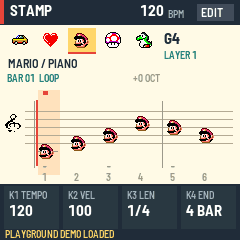
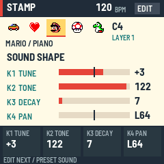
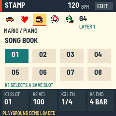
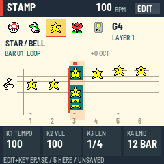
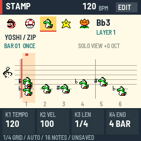
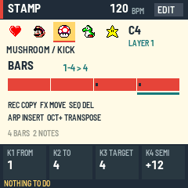
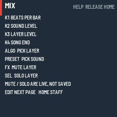

# STAMP

Stamp Composer FM-1 turns the M-VAVE FM-1 into a little music maker in the spirit of Mario Paint. Pick a character stamp, press a key, and a note lands on the staff. Each of the 31 stamps is its own sound, so a song is a picture you can hear.

> **Not yet tested on a physical FM-1.** The firmware runs in the fm1-emu emulator in your browser. Read the install page before putting it on a real unit.

---

## Contents

1. The screen
2. Your first song in two minutes
3. The pages
4. Writing and editing notes
5. The 31 sounds
6. MIDI
7. Groove
8. Bars
9. Saving, autosave and backup
10. Help, mirror and limits
11. Install, go back and recovery

---

## Your FM-1 at a glance

 with each control's job in Stamp Composer")

This manual uses the names printed on the panel: **PRESETS** (the knob that picks the stamp), **ALGORITHM** (picks the layer), **SELECT** (moves the cursor), **SCL** (the button next to FX), and **KNOB1** to **KNOB4**, written **K1** to **K4**. K1 to K4 follow the four tiles on the screen, left to right: whatever the tile in that place says is what that knob does on the current page. (The panel's calibration screen asks for SCL as "SEL"; it is the same button, and the on-screen hint lines shorten some names to ALGO, PRESET and SEL.) MASTER is the unit's own volume and the firmware does not use it for anything else.

## Page by page

**EDIT** (a quick tap) steps through the pages; **GLO** opens the song book; **HOME** goes back to the staff. What the four knobs do on each page:

| Button | Page | K1 | K2 | K3 | K4 |
| --- | --- | --- | --- | --- | --- |
| HOME | STAFF | tempo | velocity | length | song end |
| EDIT | MIX | beats per bar | sound volume | layer volume | song end |
| EDIT | SOUND | tune | tone | decay | pan |
| EDIT | MIDI | channel | mode | clock | MIDI-in channel |
| EDIT | GROOVE | swing | human | swing grid | human mode |
| EDIT | BARS | from bar | to bar | target bar | transpose amount |
| GLO | Song book | slot | velocity | length | none |

On every page PRESETS picks the sound and ALGORITHM picks the layer. Section 3 has every button on every page.

## Grips

The buttons that do something different when you combine them. Nothing here needs more than two hands.

| Grip | What happens |
| --- | --- |
| Several keys together | A chord: every note lands on the same step |
| A note key again | Press a note key where that note already is (same pitch, sound, layer, at the cursor) and it is removed: ERASED. One undo step; chords toggle note by note. (While playing a repeat is skipped, not removed) |
| EDIT + key | Erase that pitch at the cursor on any sound or layer (the selected sound's first, else the most recently added); NOTHING TO ERASE if there is none. At the playhead while playing. The page does not change |
| EDIT + FX | On the staff: clear every note at the cursor (only the selected sound's with SCL on), one undo step: CLEARED n NOTES |
| EDIT + SELECT | On the staff: jump the cursor to the previous or next step that has a note (SCL on: selected sound only), whatever the grid |
| EDIT + K2 or K3 | On the staff: change the velocity or length of the selected sound's notes at the cursor |
| EDIT + PLAY | Play from the start of the cursor's bar |
| EDIT + OCT− or OCT+ | On the staff: spelling toward flats or sharps, and respell the notes at the cursor |
| OCT− + OCT+ together | FREE PLAY on or off: keys only play, never write. Press the second within 150 ms of the first |
| OCT− or OCT+ on BARS | Transpose the bars down or up (after a 150 ms wait, so the two together still mean FREE PLAY) |
| Hold HOME | After about half a second, a list of this page's controls; let go and it goes away |
| REC twice (song book) | The first press arms a load, the second loads the slot; HOME cancels |
| FX or SCL on MIX | Mute or solo the layer (everywhere else: mute the sound, filter the view) |
| Hold OCT− + OCT+ while powering on | **Not a song grip.** Opens the platform's panel calibration (see "If something goes wrong") |
| Hold REC while powering on | **Not a song grip.** Opens the chip's update mode (see "If something goes wrong") |

---

## 1. The screen

The 240 by 240 screen has four parts, top to bottom.

- **Header.** The name STAMP, the tempo in BPM, and a small badge that says EDIT, or PLAY while the song is playing. When the FM-1 follows an outside clock, BPM changes to EXT and the number shows the tempo it has measured.
- **Character ribbon.** Five stamps in a row. The one in the highlighted box is your current sound; turn PRESETS to slide the row along. To its right are the last note you played (like C4) and your layer (LAYER 1 to 8). A layer that is muted shows M, and when other layers are soloed this one shows OFF. A muted sound is drawn as a checkered stamp with an M. A line under the ribbon names the sound, like MARIO / PIANO.
- **The staff.** Six steps are shown at a time, numbered along the bottom, with the bar number and LOOP on or off, and the octave shift. Notes appear as the character that plays them. Sharps are marked, extra lines appear for high and low notes, and the staff slides to another octave band when you play out of range. While a song plays, your selected character hops along the staff in time.
- **Four knob tiles and the status line.** The tiles show what knobs K1 to K4 do right now and their values. Under them, the status line shows the grid, the note count and SAVED or UNSAVED. Short messages (SAVED, STOP FIRST, SONG FULL) flash there for a moment.

---

## 2. Your first song in two minutes

1. Turn **PRESETS** to pick a character. Press a few keys on the STAFF page: each one plays and places a note at the cursor. Press a note again to remove it.
2. Turn **SELECT** to move the cursor one step along. Place another note.
3. Press several keys together for a **chord**. They all land on the same step.
4. Press **SEQ** to change the step size, then add quicker notes.
5. Press **PLAY**. Press it again to stop.
6. Not happy? **ENV** takes back your last change and **LFO** puts it back.
7. Turn **ALGORITHM** to pick another layer, change **PRESETS** to another character, and add a second part.
8. Turn **K1** to change the tempo, and press **ARP** to loop the song.
9. Press **SAVE** to keep the song in the current slot. Your work is also saved on its own (see section 9).

Notes are written on the STAFF page. On every other page the keys only play the selected sound.

---

## 3. The pages

**EDIT** (a quick tap) steps through the pages in this order: STAFF, MIX, SOUND, MIDI, GROOVE, BARS, then back to STAFF. **GLO** opens the song book, and a second press returns to the staff. **HOME** goes straight back to the staff with the cursor at the start. On every page, PRESETS picks the sound and ALGORITHM picks the layer.

### STAFF

| Control | What it does |
| --- | --- |
| Note keys | Play a note and place it at the cursor (while playing: at the playhead, see section 4). Several keys make a chord. The keyboard covers F3 to G5; notes must land between C2 and C6 |
| SELECT | Move the cursor by one grid step. With EDIT held: jump to the previous or next step that has a note, off the grid too |
| PRESETS | Choose one of the 31 sounds (wraps, like the ribbon) |
| ALGORITHM | Choose layer 1 to 8 |
| K1 | Tempo, 30 to 300 BPM (stopped only) |
| K2 | Velocity (how hard) for new notes |
| K3 | Length of new notes |
| K4 | Song end, in whole quarter notes; it cannot cut off notes already placed (stopped only). The tile shows bars and beats: 4B+2 is 4 bars and 2 beats, 4 BAR is exactly four |
| PLAY | Start from the beginning, or stop |
| EDIT | Tap for the next page (a clean tap: pressing anything else while holding EDIT does not change the page). Hold it for erasing and note editing (section 4) |
| SEQ | Change the grid (stopped only) |
| ARP | Loop the whole song on or off (stopped only) |
| REC | Copy the cursor's bar into the next bar (stopped only) |
| FX | Mute or unmute the selected sound: it goes silent (audio and MIDI) but its level is kept. Works while playing; not saved |
| SCL | Show every sound, or only the selected one (a view filter) |
| ENV, LFO | Undo, redo (stopped only) |
| OCT−, OCT+ | Move the keyboard down or up an octave. With EDIT held: spelling, sharps or flats (section 4) |
| SAVE | Save to the current slot (stopped only) |
| GLO, HOME | Song book, back to the staff |

### MIX

| Control | What it does |
| --- | --- |
| K1 | Beats per bar, 2 to 12 (the time signature is the number over 4; stopped only) |
| K2 | Volume of the selected sound; 0 mutes it (stopped only) |
| K3 | Volume of the selected layer; 0 mutes it (stopped only) |
| K4 | Song end (stopped only) |
| ALGORITHM | Pick the layer |
| FX | Mute or unmute the layer, even while playing |
| SCL | Solo or unsolo the layer, even while playing |

Only on MIX do FX and SCL work on the layer. On every other page except BARS, FX mutes the sound and SCL filters the view. Mute and solo are for performing. They are not saved and reset at power-up. A silent layer sends no MIDI either. If any layer is soloed, only soloed layers sound.

### SOUND

| Control | What it does |
| --- | --- |
| K1 | Tune, −12 to +12 semitones |
| K2 | Tone, 0 dark to 127 open |
| K3 | Decay, 0 short to 127 long |
| K4 | Pan, L64 through centre to R63 |

### MIDI

The page shows all 31 sounds in a grid of 8 by 4 small stamps, each with its channel (-- = off) and the selected one highlighted; PRESETS moves the highlight.

| Control | What it does |
| --- | --- |
| K1 | This sound's MIDI channel: OFF or 1 to 16 |
| K2 | Mode: OFF, ON, or MIDI ONLY |
| K3 | Clock: OFF, OUT, or IN |
| K4 | MIDI-in channel: OMNI (every channel) or 1 to 16. Notes on other channels are ignored; clock and Start/Stop always get through |

### GROOVE

| Control | What it does |
| --- | --- |
| K1 | Swing, 0 to 75 |
| K2 | Human, 0 to 100 |
| K3 | Swing grid: 8TH (off-beat eighths) or 16TH (off-beat sixteenths) |
| K4 | Human mode: TIME+VEL, TIME only, or VEL only |

### BARS

| Control | What it does |
| --- | --- |
| K1 | FROM bar |
| K2 | TO bar (never before FROM) |
| K3 | TARGET bar |
| SELECT | Choose the FROM bar (TO follows if needed) |
| K4 | Transpose amount, 1 to 12 semitones |
| REC | Copy the bars to TARGET |
| FX | Move the bars to TARGET |
| SEQ | Delete the bars |
| ARP | Insert empty bars at FROM |
| OCT− | Transpose the bars down by K4 |
| OCT+ | Transpose the bars up by K4 (OCT− and OCT+ together still toggle FREE PLAY, so a single press waits a moment) |
| SCL | Copy, move and transpose touch only the selected sound |

On SOUND, MIDI, GROOVE and BARS the knobs only turn while the song is stopped; refused changes say STOP FIRST. On these pages, MIX and the song book, the keys only audition the selected sound, and REC (bar copy), SEQ and ARP do nothing; they belong to the STAFF page. A hint line at the bottom of each page lists the main buttons.

### Song book

| Control | What it does |
| --- | --- |
| K1, SELECT | Choose the slot, 1 to 8, then DEMO |
| K2, K3 | Velocity and length of new notes |
| FX | Mute or unmute the selected sound |
| SAVE | Write the song into that slot (on DEMO: refused, PICK A SLOT) |
| REC | First press arms a load, second press loads the slot (on DEMO: loads Twinkle Twinkle, then the staff) |
| GLO or HOME | Back to the staff |

---

## 4. Writing and editing notes

**Chords.** Press more than one key while the cursor stays put. The cursor only moves when you turn SELECT.

**Erase.** There are four ways, all on the staff, all one undo step, none of them change the page:

- **Press the note again.** A key (or MIDI note) for a note that is already at the cursor with the selected sound and layer removes it: ERASED C4 PIANO. A chord removes note by note. A removed note makes no sound.
- **Hold EDIT and press a key.** That pitch is erased at the cursor on any sound or layer. If the selected sound has it, that one goes (the first, if it is on several layers); otherwise the most recently added one goes. Press again for the next. If nothing matches it says NOTHING TO ERASE.
- **Hold EDIT and press FX.** Every note at the cursor goes (with **SCL** on, only the selected sound's): CLEARED 3 NOTES.
- **Hold EDIT and turn SELECT.** The cursor jumps to the previous or next step with a note in it (selected sound only with SCL on), whatever the grid, so you can always land exactly on a note even if you placed it live or on another grid. Plain SELECT still moves by grid steps. NO MORE NOTES means there is none further.

The notes at the cursor are drawn on a teal box, and the status line reads EDIT+KEY ERASE, so you can see what will go. While the song plays, a repeated key is skipped as before (no toggle), and EDIT plus a key erases that pitch at the playhead's step on any sound.

**Edit notes you already placed.** Hold **EDIT** on the staff and turn **K2** to change the velocity, or **K3** to change the length, of the selected sound's notes at the cursor. The status line shows NOTE VEL or NOTE LEN. One hold is one undo step. If nothing is there it says NO NOTE HERE.

**Sharps and flats.** Every black key can be written as a sharp (C#) or a flat (Db); it sounds the same. The staff puts a flat on the line or space of the next letter up, with a flat sign (Bb sits on the B line), and the header name reads Bb3 or Eb4. New notes follow the spelling mode, shown in the status line: SHARP, FLAT, or AUTO (the default), which writes D#, G#, A# as Eb, Ab, Bb and C#, F# as sharps. Hold **EDIT** and press **OCT−** to step toward FLAT (SHARP, AUTO, FLAT), or **OCT+** toward SHARP. The press also respells the selected sound's black-key notes at the cursor in that mode (one undo step, stopped only), so pressing it again fixes a chord you entered the other way. The mode is not saved. Keys, MIDI notes and live placement use it. A single press acts after a tenth of a second, so OCT− and OCT+ together still switch FREE PLAY. BARS transpose keeps a flat if the note lands on a black key; a white key becomes a sharp or flat as the mode says. A flat and a sharp of the same pitch at the same place count as the same note.

**Undo and redo.** **ENV** undoes and **LFO** redoes, up to 16 changes. Both only work while stopped.

**Grids.** **SEQ** cycles 1/4, 1/8, 1/16, then the triplet grids 1/8T and 1/16T. The cursor snaps to the new grid. K3 changes length in steps of a 16th, or a triplet 16th on the triplet grids, from one step up to 16 beats.

**Time signature.** On MIX, turn **K1** for 2 to 12 beats per bar. Bar lines, bar numbers, bar copy and the song end all follow it. The default is 4.

**Play from the cursor.** Hold **EDIT** and press **PLAY**. The song starts at the beginning of the cursor's bar. With MIDI clock out, it sends a position message and Continue rather than Start.

**Live placement.** While the song plays, a key (or a MIDI note) sounds at once and also lands in the song at the playhead, rounded to the nearest step of the grid (triplet grids too). Past the end of the song it lands at the loop start if looping, otherwise on the last step. A note already there is not added twice, and a full song says SONG FULL. Hold **EDIT** and press a key to erase that pitch (any sound) at the playhead's step; a plain repeated key is skipped, not removed. Everything you place or erase in one playback run is one undo step. A note placed a little ahead of the playhead sounds again when the playhead reaches it.

**Free play.** Press **OCT-** and **OCT+** together (the second within a tenth of a second of the first) to switch FREE PLAY on or off. The header badge says FREE. Keys then only play the selected sound, stopped or over the song, and never place or erase notes; a note lasts as long as you hold the key. A single OCT press still shifts the octave (on BARS it transposes the bars instead, with EDIT held on the staff it sets the spelling, and both together still toggle FREE PLAY there). FREE PLAY keys work on every page. Free play is not saved.

**Stopped only.** Settings knobs, bars operations, undo, redo and saving work only while the song is stopped.

---

## 5. The 31 sounds

Each stamp has its own sound. Turn **PRESETS** to choose.

| Stamp | Sound | Stamp | Sound |
| --- | --- | --- | --- |
| Mario | Piano | Coin | Coin |
| Mushroom | Kick | Shy Guy | Shy Guy |
| Yoshi | Zip | Boo | Boo |
| Star | Bell | Luigi | Luigi |
| Flower | Trumpet | Peach | Peach |
| Game Boy | Pulse | Feather | Feather |
| Dog | Dog | Bullet Bill | Bullet |
| Cat | Cat | Goomba | Goomba |
| Pig | Pig | Bob-omb | Bob-omb |
| Swan | Horn | Spiny | Spiny |
| Face | Baby | Fruit | Fruit |
| Plane | Guitar | 1-Up | 1-Up |
| Boat | Block | Moon | Moon |
| Car | Organ | Egg | Egg |
| Heart | Bass | Gnome | Gnome |
| Piranha Plant | Piranha |  |  |

The sounds are the Mario Paint sound pack (`assets/sounds/`, with its own notice): Nintendo's sounds, so not under this project's MIT license, and a swappable asset pack.

**Shaping.** On the SOUND page each sound gets its own tune, tone, decay and pan. Tone is a gentle filter, decay sets how long a note rings after its length, and pan places it left or right. A fresh song starts neutral: tune 0, tone 127, decay 0, pan centre. These are saved with the song and can be undone.

**Levels.** On MIX, each sound and each of the eight layers has a volume. Quick mute of a sound: press FX on any page except MIX or BARS. The sound goes silent (audio and MIDI) while its level stays as it was, and FX again brings it back. A mute is for performing: it is not saved and resets at power-up.

---

## 6. MIDI

The FM-1 can play other gear while it plays itself.

- **Out, per sound.** On the MIDI page pick a channel for the sound (OFF or 1 to 16). Every note sends a note-on with its velocity and a note-off after its length. Tune applies. When you stop, everything is silenced. Notes you audition go out too.
- **Mode.** OFF sends nothing, **ON** plays the internal sound and sends MIDI, **MIDI ONLY** mutes the internal sound so you can drive a synth.
- **Clock OUT.** The FM-1 sends start, stop and clock at the song's tempo.
- **Clock IN.** Set K3 to IN and the FM-1 follows an outside machine: its Start plays from the beginning, Continue picks up where it stopped, Stop stops. The header shows EXT and the tempo it measured. PLAY still starts and stops by hand, at that tempo. If the clock goes quiet for half a second, playback carries on at the last tempo and locks again when the clock returns. IN does not send clock out.
- **Notes in.** A note arriving over USB, Bluetooth or the MIDI jack acts like a key: on the STAFF page, while stopped, it plays and places a note at the cursor with your selected sound and layer, using the incoming velocity (while playing it lands at the playhead; on other pages it only plays). Notes outside C2 to C6 are ignored. Set K4 on the MIDI page to listen to one channel only; clock and Start/Stop messages are not filtered.

---

## 7. Groove

Two knobs on the GROOVE page make a plain pattern feel alive.

- **Swing** (0 to 75) delays the off-beat notes of one grid, so the beat skips. K3 picks the grid: 8TH delays the off-beat eighths, 16TH the off-beat sixteenths.
- **Human** (0 to 100) nudges every note a little in time and loudness. K4 picks what moves: TIME+VEL, TIME only or VEL only. The same nudges happen on every play, so a song sounds the same each time.

Both are saved with the song. At 0 and 0 the song plays exactly as written. Notes you audition while writing are not swung.

**Swing and triplets.** Swing delays the off-beats of the chosen grid. Notes on triplet positions are not swung, because triplets already carry the swung feel. Swing 33 moves an off-beat eighth onto the triplet position.

---

## 8. Bars

The BARS page works on a run of bars at once. Choose FROM and TO (the range, inclusive) and a TARGET bar, then press a button.

- **REC copies** the range to TARGET. Notes already there are kept and exact duplicates are skipped. The song grows if it must.
- **FX moves** the range.
- **SEQ deletes** the bars. Later bars slide left.
- **ARP inserts** empty bars at FROM. Later bars slide right.
- **OCT+ transposes** the range by K4 semitones.

Turn on SCL first if copy, move or transpose should touch only the selected sound. Delete and insert always take all sounds. If an action would not fit (more than 384 notes, over the length limit, notes leaving C2 to C6, or nothing to do) it is refused whole and a message says why. Each action is one undo step.

---

## 9. Saving, autosave and backup

**Eight slots.** In the song book choose a slot with K1 and press **SAVE**. The status line then reads SAVED. To load, press **REC** twice (the first press arms it, the second loads it). Loading can be undone. HOME cancels an armed load. Stop the song before saving, because audio pauses for a moment while the FM-1 writes.

**Demo.** After slot 8 the song book has a DEMO entry: Twinkle Twinkle, one of the three demo songs of the original Mario Paint (a public-domain melody; this is our own arrangement: STAR melody over a HEART bass, 12 bars, 100 BPM, looping). REC twice loads it like a slot, and ENV undoes the load. It is never overwritten: SAVE on DEMO is refused. The browser's Load Twinkle demo button does the same.

**Autosave.** After 3 seconds with no key or button pressed and no change, and the song stopped, the working song is quietly written to the FM-1, at most every 20 seconds. At power-on it comes back exactly as you left it, with the message RESTORED and its slot and UNSAVED mark. If no autosave can be read, slot 1 loads instead.

**Backup and restore over USB.** The site's Backup page, or the backup tool, saves all eight slots to one file and restores them all together. Stop playback first. A backup holds the eight saved slots only, so press SAVE on anything you want included. After a restore, the working song is replaced by the reloaded slot.

---

## 10. Help, mirror and limits

**Help overlay.** Hold **HOME** for about half a second and a full-screen list of this page's controls appears. Let go and it disappears; nothing else happens, and playback keeps going. A quick tap of HOME just returns to the staff.

**Screen mirror.** With `mirror = true` in the firmware's settings, the screen and panel can be mirrored to a computer over USB. The screen redraws fully every frame, so it recovers on its own.

**Limits.**

| What | Limit |
| --- | --- |
| Notes per song | 384 |
| Pitch range | C2 to C6 (the keys cover two octaves and a bit; OCT− and OCT+ move them) |
| Tempo | 30 to 300 BPM |
| Beats per bar | 2 to 12 |
| Song length | 65,535 ticks (a quarter note is 96 ticks) |
| Layers | 8 |
| Song slots | 8 |
| Undo steps | 16 |
| Playing at once | 8 voices in this build |

The main controls for notes and settings are locked while the song plays. Navigation, sound and layer choice, sound mute (FX), MIX layer mute and solo, velocity and length for new notes on the STAFF, keys (they play, and place on the staff) and octave still work. On MIX the K2 and K3 level knobs are locked while playing and say STOP FIRST.

---

## 11. Install, go back and recovery

Installing, backing up the stock firmware and returning to stock are on the Install page: [Install, back up, go back](../install/). Read it before you begin. This firmware has not yet been tested on a physical FM-1; everything below is what the platform code does, read from its source and run in emulators, not something seen on a unit.

### If something goes wrong

- **Normal start.** The boot screen, then the staff, with your last working song back (RESTORED). Nothing needs to be held.
- **Safe mode.** If the firmware crashes or hangs twice in a row while starting (within about 30 seconds of power-on each time), the next start shows STAMP SAFE MODE: no sound, no song, USB on. Press **PLAY** to try the firmware again, or reinstall from the Install page, which works from here. If even safe mode fails to come up twice more, the chip drops into its own update mode.
- **Update mode.** Holding **REC** while you power on, or **REC** on the safe mode screen, opens the chip's own update mode (the screen says UPDATE MODE (REC)); the FM-1 then shows up over USB as the chip's bootloader (`4C4A:8057`), ready for a firmware write. Leave it by installing something or power-cycling.
- **Panel calibration.** Holding **OCT− and OCT+ together while you power on** opens the platform's HARDWARE CALIBRATION, which asks you to press every button and turn every knob in turn. Finishing it rewrites the stored panel map, so only do it on purpose. If you open it by accident, leave it alone: after 30 seconds without input it quits and keeps the old map. While the firmware is running, nothing in the platform reacts to holding OCT− and OCT+ (there is no hold-for-update combination as in some other firmware); in this firmware a quick tap of both together is only FREE PLAY.
- **An install was interrupted.** Do not just power-cycle and hope. Connect again and run the installer again, or use the stock updater. If the unit will not start at all, use the rescue tool below.
- **Rescue tool.** `base/bsp/tools/fm1_rescue.py` (Mac or Linux) waits for the chip's update mode, backs up the whole flash first, then writes the stock firmware into the app area. It does not repair a damaged boot area.
- **Back to stock.** The installer page's "Back to the stock firmware" writes M-VAVE's firmware over the same cable; M-UPGRADE also works. Back up your songs first.
- **No MIDI reply from the installer.** Use Chrome or Edge, a data USB cable, allow MIDI access, and close other programs that hold the FM-1's MIDI port. If it still finds nothing, power-cycle the FM-1 and try again.
